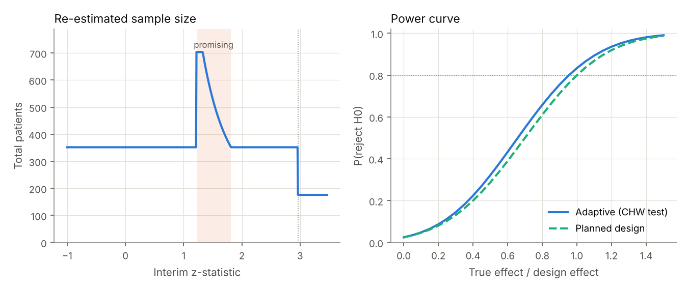

# trialdesign

[](https://github.com/rushadnihal/trialdesign/actions/workflows/ci.yml)
[](https://pypi.org/project/gsdtrial/)

Design a two-arm clinical trial before the data exist. `trialdesign` is a Python command-line
package for:

- fixed-design sample size (continuous, binary and time-to-event endpoints), for superiority
  or non-inferiority,
- group-sequential boundaries with O'Brien-Fleming-type, Pocock-type, Hwang-Shih-DeCani,
  Kim-DeMets or user-specified spending, and non-binding (default) or binding futility,
- promising-zone sample size re-estimation at an interim, with the Cui-Hung-Wang test, and
  its survival counterpart that re-estimates the number of events,
- survival accrual, follow-up and dropout: patients, study duration and the calendar time of
  each look,
- a Bayesian beta-binomial go/no-go interim with predictive probability of success and assurance,
- exact and Monte Carlo operating characteristics, including a patient-level survival
  simulator (accrual, dropout, event-driven looks, log-rank test), and a Markdown design report.

Every number is checked against R (`rpact`, `gsDesign`, `stats`). See [Validated against](#validated-against).

## Install

```bash
pip install gsdtrial
```

The package is published on PyPI as `gsdtrial`, because the name `trialdesign` there belongs to
an unrelated project. You still `import trialdesign` and run `trialdesign`. That other project
also installs a `trialdesign` import, so don't install both in the same environment.

Python 3.11 or later; depends on numpy, scipy, typer and matplotlib. For the latest
development version: `pip install git+https://github.com/rushadnihal/trialdesign`.

## 30-second quickstart

A phase 3 survival trial with hazard ratio 0.70, 80% power, one-sided alpha 0.025, two interim
looks, O'Brien-Fleming-type efficacy and Pocock-type non-binding futility
([`examples/phase3_survival.toml`](https://github.com/rushadnihal/trialdesign/blob/main/examples/phase3_survival.toml)):

```bash
trialdesign design --endpoint survival --hr 0.7 --prob-event 0.75 \
    --looks 0.33,0.67,1 --spending obf --futility pocock
```

```text
trialdesign 0.2.0 | group-sequential design (output abridged) | alpha is one-sided
  fixed events (alpha_two_sided 0.05)  246.7871
  inflation_factor                     1.2437
  max_events                           307
  max_n_total                          410

Boundaries
Look  Info fraction  Cumulative events  Efficacy z  Nominal p (1-sided)  Cumulative alpha  Futility z
1            0.3300                102      3.7307             9.55e-05          9.55e-05      0.4530
2            0.6700                206      2.5039               0.0061            0.0062      1.3293
3            1.0000                307      1.9937               0.0231            0.0250      1.9937
```

Then simulate it and write a report with plots:

```bash
trialdesign simulate --config examples/phase3_survival.toml --nsim 200000 --seed 2026
trialdesign report --config examples/phase3_survival.toml --out results/
```


Operating characteristics of this design. Exact values come from recursive numerical
integration; simulated values use 200,000 trials (seed 2026), each with its Monte Carlo SE and
z = (simulated − exact) / SE:

| Quantity | Exact | Simulated | MC SE | z vs exact |
| --- | --- | --- | --- | --- |
| Type I error (futility ignored) | 0.0250 | 0.0251 | 0.0003 | +0.33 |
| Power (futility followed) | 0.8000 | 0.7994 | 0.0009 | −0.63 |
| Expected events under H0 | 142.6 | 142.6 | 0.14 | +0.24 |
| Expected events under H1 | 227.0 | 226.9 | 0.15 | −0.59 |

Futility is non-binding: boundaries and type I error are computed as if futility were ignored,
so alpha is controlled whether or not the data monitoring committee stops. Following futility
cuts the expected number of events under H0 from 307 to 143.

A Bayesian phase 2 interim works the same way
([`examples/phase2_binary_bayes.toml`](https://github.com/rushadnihal/trialdesign/blob/main/examples/phase2_binary_bayes.toml)):

```bash
trialdesign bayes --pc 0.30 --pt 0.45 --n 60 --interim 30 --go 0.9 --nogo 0.1 --xc 6 --xt 12
```

[`docs/design_memo.md`](https://github.com/rushadnihal/trialdesign/blob/main/docs/design_memo.md)
uses it to design a fictional phase 2 trial, written the way it would be presented to a
clinical team, with an addendum that sizes the follow-on phase 3 with sample size
re-estimation.

For non-inferiority, give the effect under H0: `--delta0` for a difference in means or rates
(treatment minus control), `--hr0` for a hazard ratio. Here both arms respond at 85% and
treatment must not be worse by 10 points
([`examples/phase3_ni_binary.toml`](https://github.com/rushadnihal/trialdesign/blob/main/examples/phase3_ni_binary.toml)):

```bash
trialdesign design --endpoint binary --pc 0.85 --pt 0.85 --delta0 -0.10   # 207 per arm
trialdesign design --endpoint survival --hr 1.0 --hr0 1.3 --looks 3       # 504 events
```

For a survival design, an accrual model turns events into patients and calendar time
(Lachin-Foulkes, exponential events and dropout, as in `rpact`). Give the control median and
two of accrual time, accrual rate and follow-up; the third is solved
([`examples/phase3_survival_accrual.toml`](https://github.com/rushadnihal/trialdesign/blob/main/examples/phase3_survival_accrual.toml)):

```bash
trialdesign design --endpoint survival --hr 0.7 --looks 3 --median-control 12 \
    --accrual-time 24 --followup 12 --dropout 0.05
# 250 events, 391 patients; looks expected at months 16.6, 25.1 and 36.0
```

Piecewise accrual takes one rate per segment, e.g. `--accrual-time 6 --accrual-rate 10,25
--followup 12` for a 6-month ramp-up (the end of accrual is solved).

The non-inferiority test is one-sided in the direction of the alternative. For a binary endpoint the variance
under H0 uses the Farrington-Manning restricted maximum likelihood rates, as `rpact` and
`gsDesign::nBinomial` do.

### Sample size re-estimation

`trialdesign ssr` plans a two-look design and adds a promising-zone rule (Mehta and Pocock
2011): if the conditional power at the observed interim trend lies between `--cp-min` and
`--cp-target`, the second stage grows until it reaches `--cp-target`, up to `--max-factor`
times the planned maximum. The final test weights the stages by their planned information
(Cui, Hung and Wang 1999), so alpha is controlled exactly whatever the interim shows
([`examples/phase3_ssr.toml`](https://github.com/rushadnihal/trialdesign/blob/main/examples/phase3_ssr.toml)):

```bash
trialdesign ssr --config examples/phase3_ssr.toml            # zones and exact OCs
trialdesign ssr --config examples/phase3_ssr.toml --z1 1.5   # apply the rule to an interim
```

```text
Zone                 Interim z1  Observed / design effect  Total patients
Unfavourable            < 1.213                   < 0.611             352
Promising        1.213 to 1.813            0.611 to 0.913      352 to 704
Favourable       1.813 to 2.963                  >= 0.913             352
Efficacy (stop)        >= 2.963                                       176
```

Operating characteristics are exact (one-dimensional integration over the interim z), with a
simulated check. With these defaults (CP 0.36 to 0.8, cap 2x, interim at half), power at
the design effect rises from 0.800 to 0.834 for 37 more patients on average; at 70% of the
design effect, from 0.500 to 0.548. Pooling all patients in a naive final test would also hold
alpha for this promising-zone rule (0.0244), but not for a rule that adapts in every zone
(0.0303 with `--cp-min 0`), which is why the weighted test is always used.



### Spending functions and binding futility

`--efficacy` and `--futility` take any of these, in flags and in `[sequential]`:

| Value | Spending | Cumulative error spent by information fraction t |
| --- | --- | --- |
| `obf` | Lan-DeMets O'Brien-Fleming-type | 2 - 2 Phi(z_(1-a/2) / sqrt(t)) |
| `pocock` | Lan-DeMets Pocock-type | a log(1 + (e - 1) t) |
| `hsd:<gamma>` | Hwang-Shih-DeCani, e.g. `hsd:-4` | a (1 - exp(-gamma t)) / (1 - exp(-gamma)) |
| `kd:<rho>` | Kim-DeMets power, e.g. `kd:3` | a t^rho |
| `user:<f1>,...,1` | User-specified, e.g. `user:0.1,0.4,1` | a times the given fraction at each look |

Futility is non-binding unless you ask otherwise. `--binding-futility` (or
`binding_futility = true`) solves the efficacy and futility boundaries together, assuming every
futility stop is made: the efficacy boundaries drop and the trial gets smaller, but alpha holds
only if the committee always stops. The output then shows how far alpha rises if futility is
ignored. For the quickstart trial with `--efficacy hsd:-4 --futility hsd:-2`:

| | Max events | Final z | Type I error, futility followed | Type I error, futility ignored |
| --- | --- | --- | --- | --- |
| Non-binding | 264 | 1.9996 | 0.0233 | 0.0250 |
| Binding | 258 | 1.9648 | 0.0250 | 0.0268 |

Binding futility is not available with sample size re-estimation.

#### Survival: re-estimating the number of events

For a time-to-event endpoint, `trialdesign ssr` re-estimates the number of events instead.
The interim is at half the planned events and the cap (`--max-factor`, default 1.5 for
survival) applies to total events. The stage-2 statistic is the log-rank score increment
between the two analyses, which has independent increments (Tsiatis 1981), so the same
weighted test holds alpha. It needs the accrual model, which turns events into calendar time
and patients. `--extend followup` (default) follows the enrolled patients longer;
`--extend accrual` enrols more at the last accrual rate:

```bash
trialdesign ssr --endpoint survival --hr 0.7 --median-control 12 --accrual-time 18 \
  --followup 12 --z1 1.5 --nsim 10000
```

```text
Zone                 Interim z1  Observed / design effect  Total events
Unfavourable            < 1.213                   < 0.611           248
Promising        1.213 to 1.813            0.611 to 0.913    248 to 372
Favourable       1.813 to 2.963                  >= 0.913           248
Efficacy (stop)        >= 2.963                                     124
```

The output adds the expected study duration of each scenario and the month of the final
analysis at the cap. Following 396 patients until 372 events takes until month 69 here, against
37 with `--extend accrual`; check that before choosing the cap. `--nsim` checks the design with
the patient-level simulator, which re-estimates the events at the interim log-rank z. Alpha is
controlled only if the interim decision uses the log-rank statistic alone: using other data from
stage-1 patients (progression, biomarkers) breaks the independent increments (Bauer and Posch
2004; Jenkins, Stone and Jennison 2011).

The defaults come from a grid over the cap (1.25, 1.5, 2) and `--cp-min` (0.2, 0.36, 0.5) for
the same trial with 600 patients. At a hazard ratio of 0.75 against a design value of 0.7, the plain design has
power 0.618; cap 1.5 with CP 0.36 to 0.8 gives 0.656 for 21 more events and 1.4 more months on
average; a cap of 2 with `--cp-min 0.2` gives 0.699 for 51 more events and 4.6 more months. The
power per extra event is about the same across the grid, so the cap mostly trades duration
for power. The exact characteristics use the Schoenfeld information D r / (1 + r)^2; with
unequal allocation the log-rank test's power departs from it by about a point, and the
patient-level check is the better guide.

## Command line

| Command | Does |
| --- | --- |
| `trialdesign design` | Fixed or group-sequential sample size and boundaries, with exact operating characteristics |
| `trialdesign simulate` | Monte Carlo operating characteristics under H0 and H1, next to the exact values; `--engine patient` simulates patients and the real test |
| `trialdesign bayes` | Bayesian go/no-go interim: exact OCs, posterior, PPoS and decision for observed data, assurance |
| `trialdesign ssr` | Promising-zone sample size (survival: event) re-estimation: zones, exact OCs, the rule applied to an interim z |
| `trialdesign report` | `report.md` plus PNG plots of the boundaries and operating characteristics |

Each command takes flags, a TOML design file (`--config`), or both; flags override the file.
Output is a plain table, or JSON with `--json`. Only `report --out` writes to disk, and every
simulation prints its seed and the package version. Alpha always names its sidedness: fixed
designs report two-sided alpha (default 0.05), group-sequential designs one-sided (default
0.025). Run `trialdesign COMMAND --help` for every option.

`simulate` has two engines. The default, `score`, draws the canonical z-scale process: fast,
and exactly what the boundaries assume. `--engine patient` (or `engine = "patient"` under
`[simulation]`) simulates patients and the test you would run on them: the t-test for a
normal endpoint, the Farrington-Manning z-test for a binary one (including non-inferiority),
and the log-rank test with accrual and dropout for survival. It defaults to 10,000 trials and
shows how far the large-sample theory holds for your design:

```bash
trialdesign simulate --endpoint survival --hr 0.7 --median-control 12 --accrual-time 24 \
  --followup 12 --looks 3 --engine patient --seed 1
```

## Python API

```python
from trialdesign import bayes, boundaries, fixed, simulate

d = boundaries.group_sequential_design(
    [1 / 3, 2 / 3, 1.0],
    alpha_one_sided=0.025,
    power=0.80,
    efficacy_spending="obf",
    futility_spending="obf",  # or "hsd:-2", "kd:2", "user:0.25,0.5,1"
    binding_futility=False,  # the default
)
d.efficacy, d.futility, d.inflation_factor
d.max_sample_size(fixed.events_survival(0.70).events)  # max events = fixed events x IF

sim = simulate.simulate_design(d, n_sim=200_000, seed=2026)
sim.type_i_error, sim.h0_ignore_futility.reject_prob_se  # futility ignored
sim.power, sim.h1.reject_prob_se

from trialdesign import accrual, patients

study = accrual.survival_study(250, 0.70, 12, accrual_time=24, followup=12)
ps = patients.simulate_survival(study, d.info_rates, d.efficacy, d.futility, n_sim=10_000, seed=1)
ps.reject_prob, ps.analysis_time, ps.expected_duration, ps.expected_patients
pd = patients.simulate_design_patients(  # H0 and H1, like simulate.simulate_design
    d, "binary", n_control=180, p_control=0.30, p_treatment=0.45, n_sim=10_000, seed=1
)
pd.type_i_error, pd.power

b = bayes.bayesian_interim_design(n_interim=30, n_final=60)  # control patients per analysis
b.ppos(6, 12), b.decide(6, 12)  # PPoS and go / no-go / continue at the interim
b.operating_characteristics(0.30, 0.30).prob_success  # exact type I error
b.assurance(0.30, (4.5, 5.5)).prob_success  # Beta(4.5, 5.5) design prior on p_T
bayes.calibrate_success_threshold(30, 60, alpha_one_sided=0.025)  # 0.9789
```

**Methods in one paragraph.** Every group-sequential design is reduced to a drift on the
canonical z-scale. Efficacy boundaries spend alpha with any of the spending functions above and
are solved by Jennison and Turnbull's recursive numerical integration, cross-checked against
`scipy`'s multivariate normal to 1e-4. Futility spends beta under the alternative; when it is
binding, efficacy and futility boundaries are solved look by look over the same continuation
region. The simulator draws independent increments of the score process, one
`(n_sim, looks)` matrix per batch, so 100,000 trials take well under a second. The
patient-level survival simulator checks that approximation with real patients: piecewise
accrual, permuted-block randomisation, exponential events and dropout, looks at the calendar
time of the planned event counts, and the log-rank test, vectorised over trials (10,000 trials
of 600 patients take a few seconds). The Bayesian
interim computes PPoS exactly by enumerating the beta-binomial posterior predictive, so
decisions carry no Monte Carlo error and operating characteristics and assurance are exact.
The default final success threshold, 0.98, is calibrated so the reference design (30 of 60
patients per arm at the interim) has a worst-case type I error of 0.0232, below one-sided
0.025, over common response rates from 0.05 to 0.95. `bayes --calibrate` re-calibrates it for
other designs.

## Validated against

Reference values were produced once in R and saved to JSON, so CI stays Python-only.

| What | Reference | Cases | Tolerance |
| --- | --- | --- | --- |
| Fixed sample size, normal | `stats::power.t.test` | 3 | 1e-4 |
| Fixed sample size, binary | `stats::power.prop.test`, `gsDesign::nBinomial` | 4 | 1e-4 |
| Events, time to event | `gsDesign::nEvents` (Schoenfeld) | 2 | 1e-4 |
| Spending functions | `gsDesign::sfLDOF`, `sfLDPocock` | 2 | 1e-9 |
| Efficacy boundaries and inflation factor | `rpact::getDesignGroupSequential` | 8 | 1e-3 |
| Non-binding futility boundaries | `gsDesign::gsDesign(test.type = 4)` | 4 | 1e-3 |
| Maximum events | `gsDesign::gsDesign(n.fix)` | 2 | 0.05 events |
| Expected sample size | `gsDesign` | 12 | 1e-3 |
| Posterior P(p_T > p_C), PPoS, exact OCs, assurance | independent base-R script | 20 | 1e-9 |
| Non-inferiority sample size and events | `rpact::getSampleSizeMeans`, `getSampleSizeRates`, `getSampleSizeSurvival` (`thetaH0`) | 9 | 1e-4 |
| Non-inferiority group-sequential maximum | `rpact` with a group-sequential design | 3 | 0.05 |
| Survival accrual: patients, accrual end, follow-up, study duration | `rpact::getSampleSizeSurvival` | 6 | 0.01 patients, 0.001 months |
| Conditional power at an interim (inverse normal) | `rpact::getConditionalPower` | 5 | 1e-6 |
| Re-estimation OCs: power, early stopping, expected patients | `rpact::getSimulationMeans` (100,000 runs) | 4 | 3 MC SE |
| Hwang-Shih-DeCani, Kim-DeMets and user-specified spending: boundaries, inflation factor, expected sample size | `rpact::getDesignGroupSequential` (`asHSD`, `asKD`, `asUser` and beta-spending versions) | 9 | 1e-5 |
| Binding futility boundaries, inflation factor, expected sample size | `rpact::getDesignGroupSequential(bindingFutility = TRUE)` | 5 | 1e-5 |
| Calendar time and patients at each look | `rpact::getSampleSizeSurvival` with a group-sequential design | 2 | 0.001 months, 0.05 patients |
| Patient-level survival simulation: power, type I error, look times, duration, expected patients and events | `rpact::getSimulationSurvival` (100,000 runs) | 6 | 2 MC SE (power), 3 MC SE (per look, calendar) |
| Log-rank statistic | `scipy.stats.logrank` | 5 | 1e-10 |
| Patient-level normal (t-test) and binary (Farrington-Manning) simulation, superiority and non-inferiority: power, type I error, per-look stopping, expected sample size | `rpact::getSimulationMeans`, `getSimulationRates` (100,000 runs) | 8 | 3 MC SE |
| Survival event re-estimation: conditional power given the interim log-rank z | `rpact::getConditionalPower` | 4 | 1e-6 |
| Survival event re-estimation, patient level: power, type I error, interim stops, expected events, duration and patients | `rpact::getSimulationSurvival` with `conditionalPower` (100,000 runs) | 4 | 3 MC SE |

Values: [`tests/reference_values.json`](https://github.com/rushadnihal/trialdesign/blob/main/tests/reference_values.json) (R 4.5.3, gsDesign 3.11.0,
rpact 5.0.0), [`tests/bayes_reference_values.json`](https://github.com/rushadnihal/trialdesign/blob/main/tests/bayes_reference_values.json) and
[`tests/ni_reference_values.json`](https://github.com/rushadnihal/trialdesign/blob/main/tests/ni_reference_values.json) and
[`tests/accrual_reference_values.json`](https://github.com/rushadnihal/trialdesign/blob/main/tests/accrual_reference_values.json) and
[`tests/ssr_reference_values.json`](https://github.com/rushadnihal/trialdesign/blob/main/tests/ssr_reference_values.json) and
[`tests/spending_reference_values.json`](https://github.com/rushadnihal/trialdesign/blob/main/tests/spending_reference_values.json) and
[`tests/patients_reference_values.json`](https://github.com/rushadnihal/trialdesign/blob/main/tests/patients_reference_values.json) and
[`tests/patients_endpoints_reference_values.json`](https://github.com/rushadnihal/trialdesign/blob/main/tests/patients_endpoints_reference_values.json) and
[`tests/ssr_survival_reference_values.json`](https://github.com/rushadnihal/trialdesign/blob/main/tests/ssr_survival_reference_values.json) (rpact 3.4.0).
Scripts: [`tests/r/`](https://github.com/rushadnihal/trialdesign/tree/main/tests/r/). On top of these, property tests check that one look gives
z = 1.96, that the per-look rejection probabilities under H0 sum to alpha, that PPoS is 0 or 1
with no patients left and increases with treatment responders, and that every simulated rate
lies within a few Monte Carlo SEs of its exact value.

To regenerate (needs `gsDesign` and `rpact`; the Bayesian script needs base R only):

```bash
Rscript tests/r/reference_values.R > ref.json && mv ref.json tests/reference_values.json
Rscript tests/r/bayes_reference_values.R > bayes.json && mv bayes.json tests/bayes_reference_values.json
Rscript tests/r/ni_reference_values.R > ni.json && mv ni.json tests/ni_reference_values.json
Rscript tests/r/accrual_reference_values.R > acc.json && mv acc.json tests/accrual_reference_values.json
Rscript tests/r/ssr_reference_values.R > ssr.json && mv ssr.json tests/ssr_reference_values.json
Rscript tests/r/spending_reference_values.R > sp.json && mv sp.json tests/spending_reference_values.json
Rscript tests/r/patients_reference_values.R > pat.json && mv pat.json tests/patients_reference_values.json
Rscript tests/r/patients_endpoints_reference_values.R > pe.json && mv pe.json tests/patients_endpoints_reference_values.json
Rscript tests/r/ssr_survival_reference_values.R > ssr.json && mv ssr.json tests/ssr_survival_reference_values.json
```

## Development

```bash
pip install -e ".[dev]"
pytest
pytest -m slow   # on demand: 100,000-trial type I error check of the patient-level simulator
ruff check . && ruff format --check .
```

Changes are listed in [CHANGELOG.md](https://github.com/rushadnihal/trialdesign/blob/main/CHANGELOG.md).
Releases are built and published by [`.github/workflows/release.yml`](https://github.com/rushadnihal/trialdesign/blob/main/.github/workflows/release.yml)
when a `v*` tag is pushed; see [RELEASING.md](https://github.com/rushadnihal/trialdesign/blob/main/RELEASING.md).

## Future work

The package is deliberately narrow: two arms and one primary endpoint. Not yet covered:

- multi-arm, platform and basket trials;
- equivalence (two one-sided tests);
- blinded sample size re-estimation, and enrichment designs;
- multiplicity across several endpoints (graphical testing);
- response-adaptive randomisation;
- Stan or PyMC models and dynamic borrowing;
- non-proportional hazards and non-exponential event times in the patient-level simulator.

## License

MIT
