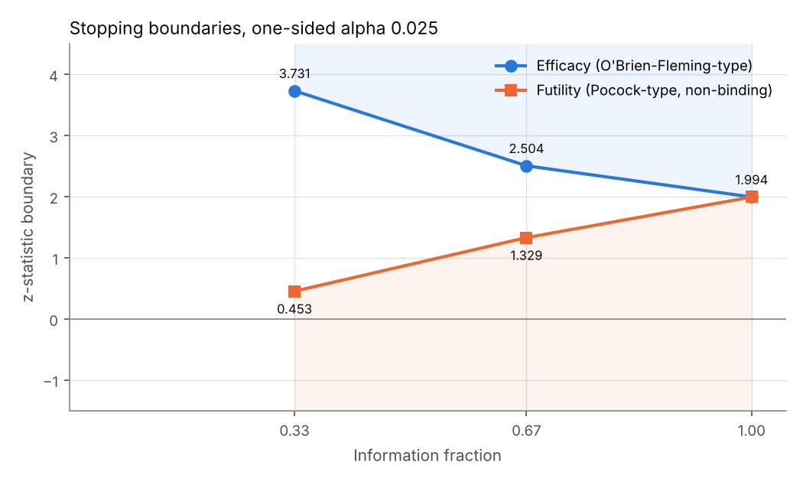

# trialdesign

[](https://github.com/rushadnihal/trialdesign-v0.1.0/actions/workflows/ci.yml)

Design a two-arm clinical trial before the data exist. `trialdesign` is a Python command-line
package for:

- fixed-design sample size (continuous, binary and time-to-event endpoints), for superiority
  or non-inferiority,
- Lan-DeMets group-sequential boundaries with non-binding futility,
- a Bayesian beta-binomial go/no-go interim with predictive probability of success and assurance,
- exact and Monte Carlo operating characteristics, and a Markdown design report.

Every number is checked against R (`rpact`, `gsDesign`, `stats`). See [Validated against](#validated-against).

## Install

```bash
pip install git+https://github.com/rushadnihal/trialdesign-v0.1.0
```

Python 3.11 or later; depends on numpy, scipy, typer and matplotlib.

## 30-second quickstart

A phase 3 survival trial with hazard ratio 0.70, 80% power, one-sided alpha 0.025, two interim
looks, O'Brien-Fleming-type efficacy and Pocock-type non-binding futility
([`examples/phase3_survival.toml`](examples/phase3_survival.toml)):

```bash
trialdesign design --endpoint survival --hr 0.7 --prob-event 0.75 \
    --looks 0.33,0.67,1 --spending obf --futility pocock
```

```text
trialdesign 0.1.0 | group-sequential design (output abridged) | alpha is one-sided
  fixed events (alpha_two_sided 0.05)  246.7871
  inflation_factor                     1.2437
  max_events                           307
  max_n_total                          410

Boundaries
Look  Info fraction  Cumulative events  Efficacy z  Nominal p (1-sided)  Cumulative alpha  Futility z
1            0.3300                102      3.7307             9.55e-05          9.55e-05      0.4530
2            0.6700                206      2.5039               0.0061            0.0062      1.3293
3            1.0000                307      1.9937               0.0231            0.0250      1.9937
```

Then simulate it and write a report with plots:

```bash
trialdesign simulate --config examples/phase3_survival.toml --nsim 200000 --seed 2026
trialdesign report --config examples/phase3_survival.toml --out results/
```



Operating characteristics of this design. Exact values come from recursive numerical
integration; simulated values use 200,000 trials (seed 2026), each with its Monte Carlo SE and
z = (simulated − exact) / SE:

| Quantity | Exact | Simulated | MC SE | z vs exact |
| --- | --- | --- | --- | --- |
| Type I error (futility ignored) | 0.0250 | 0.0251 | 0.0003 | +0.33 |
| Power (futility followed) | 0.8000 | 0.7994 | 0.0009 | −0.63 |
| Expected events under H0 | 142.6 | 142.6 | 0.14 | +0.24 |
| Expected events under H1 | 227.0 | 226.9 | 0.15 | −0.59 |

Futility is non-binding: boundaries and type I error are computed as if futility were ignored,
so alpha is controlled whether or not the data monitoring committee stops. Following futility
cuts the expected number of events under H0 from 307 to 143.

A Bayesian phase 2 interim works the same way
([`examples/phase2_binary_bayes.toml`](examples/phase2_binary_bayes.toml)):

```bash
trialdesign bayes --pc 0.30 --pt 0.45 --n 60 --interim 30 --go 0.9 --nogo 0.1 --xc 6 --xt 12
```

[`docs/design_memo.md`](docs/design_memo.md) uses it to design a fictional phase 2 trial, written
the way it would be presented to a clinical team.

For non-inferiority, give the effect under H0: `--delta0` for a difference in means or rates
(treatment minus control), `--hr0` for a hazard ratio. Here both arms respond at 85% and
treatment must not be worse by 10 points
([`examples/phase3_ni_binary.toml`](examples/phase3_ni_binary.toml)):

```bash
trialdesign design --endpoint binary --pc 0.85 --pt 0.85 --delta0 -0.10   # 207 per arm
trialdesign design --endpoint survival --hr 1.0 --hr0 1.3 --looks 3       # 504 events
```

The test is one-sided in the direction of the alternative. For a binary endpoint the variance
under H0 uses the Farrington-Manning restricted maximum likelihood rates, as `rpact` and
`gsDesign::nBinomial` do.

## Command line

| Command | Does |
| --- | --- |
| `trialdesign design` | Fixed or group-sequential sample size and boundaries, with exact operating characteristics |
| `trialdesign simulate` | Monte Carlo operating characteristics under H0 and H1, next to the exact values |
| `trialdesign bayes` | Bayesian go/no-go interim: exact OCs, posterior, PPoS and decision for observed data, assurance |
| `trialdesign report` | `report.md` plus PNG plots of the boundaries and operating characteristics |

Each command takes flags, a TOML design file (`--config`), or both; flags override the file.
Output is a plain table, or JSON with `--json`. Only `report --out` writes to disk, and every
simulation prints its seed and the package version. Alpha always names its sidedness: fixed
designs report two-sided alpha (default 0.05), group-sequential designs one-sided (default
0.025). Run `trialdesign COMMAND --help` for every option.

## Python API

```python
from trialdesign import bayes, boundaries, fixed, simulate

d = boundaries.group_sequential_design(
    [1 / 3, 2 / 3, 1.0],
    alpha_one_sided=0.025,
    power=0.80,
    efficacy_spending="obf",
    futility_spending="obf",  # futility is non-binding
)
d.efficacy, d.futility, d.inflation_factor
d.max_sample_size(fixed.events_survival(0.70).events)  # max events = fixed events x IF

sim = simulate.simulate_design(d, n_sim=200_000, seed=2026)
sim.type_i_error, sim.h0_ignore_futility.reject_prob_se  # futility ignored
sim.power, sim.h1.reject_prob_se

b = bayes.bayesian_interim_design(n_interim=30, n_final=60)  # control patients per analysis
b.ppos(6, 12), b.decide(6, 12)  # PPoS and go / no-go / continue at the interim
b.operating_characteristics(0.30, 0.30).prob_success  # exact type I error
b.assurance(0.30, (4.5, 5.5)).prob_success  # Beta(4.5, 5.5) design prior on p_T
bayes.calibrate_success_threshold(30, 60, alpha_one_sided=0.025)  # 0.9789
```

**Methods in one paragraph.** Every group-sequential design is reduced to a drift on the
canonical z-scale. Efficacy boundaries spend alpha with Lan-DeMets O'Brien-Fleming-type or
Pocock-type functions and are solved by Jennison and Turnbull's recursive numerical integration,
cross-checked against `scipy`'s multivariate normal to 1e-4. Non-binding futility spends beta
under the alternative. The simulator draws independent increments of the score process, one
`(n_sim, looks)` matrix per batch, so 100,000 trials take well under a second. The Bayesian
interim computes PPoS exactly by enumerating the beta-binomial posterior predictive, so
decisions carry no Monte Carlo error and operating characteristics and assurance are exact.
The default final success threshold, 0.98, is calibrated so the reference design (30 of 60
patients per arm at the interim) has a worst-case type I error of 0.0232, below one-sided
0.025, over common response rates from 0.05 to 0.95. `bayes --calibrate` re-calibrates it for
other designs.

## Validated against

Reference values were produced once in R and saved to JSON, so CI stays Python-only.

| What | Reference | Cases | Tolerance |
| --- | --- | --- | --- |
| Fixed sample size, normal | `stats::power.t.test` | 3 | 1e-4 |
| Fixed sample size, binary | `stats::power.prop.test`, `gsDesign::nBinomial` | 4 | 1e-4 |
| Events, time to event | `gsDesign::nEvents` (Schoenfeld) | 2 | 1e-4 |
| Spending functions | `gsDesign::sfLDOF`, `sfLDPocock` | 2 | 1e-9 |
| Efficacy boundaries and inflation factor | `rpact::getDesignGroupSequential` | 8 | 1e-3 |
| Non-binding futility boundaries | `gsDesign::gsDesign(test.type = 4)` | 4 | 1e-3 |
| Maximum events | `gsDesign::gsDesign(n.fix)` | 2 | 0.05 events |
| Expected sample size | `gsDesign` | 12 | 1e-3 |
| Posterior P(p_T > p_C), PPoS, exact OCs, assurance | independent base-R script | 20 | 1e-9 |
| Non-inferiority sample size and events | `rpact::getSampleSizeMeans`, `getSampleSizeRates`, `getSampleSizeSurvival` (`thetaH0`) | 9 | 1e-4 |
| Non-inferiority group-sequential maximum | `rpact` with a group-sequential design | 3 | 0.05 |

Values: [`tests/reference_values.json`](tests/reference_values.json) (R 4.5.3, gsDesign 3.11.0,
rpact 5.0.0), [`tests/bayes_reference_values.json`](tests/bayes_reference_values.json) and
[`tests/ni_reference_values.json`](tests/ni_reference_values.json) (rpact 3.4.0).
Scripts: [`tests/r/`](tests/r/). On top of these, property tests check that one look gives
z = 1.96, that the per-look rejection probabilities under H0 sum to alpha, that PPoS is 0 or 1
with no patients left and increases with treatment responders, and that every simulated rate
lies within a few Monte Carlo SEs of its exact value.

To regenerate (needs `gsDesign` and `rpact`; the Bayesian script needs base R only):

```bash
Rscript tests/r/reference_values.R > ref.json && mv ref.json tests/reference_values.json
Rscript tests/r/bayes_reference_values.R > bayes.json && mv bayes.json tests/bayes_reference_values.json
Rscript tests/r/ni_reference_values.R > ni.json && mv ni.json tests/ni_reference_values.json
```

## Development

```bash
pip install -e ".[dev]"
pytest
ruff check . && ruff format --check .
```

## Future work

The package is deliberately narrow: two arms and one primary endpoint. Not yet covered:

- multi-arm, platform and basket trials;
- equivalence (two one-sided tests);
- sample size re-estimation and enrichment designs;
- multiplicity across several endpoints (graphical testing);
- response-adaptive randomisation;
- Stan or PyMC models and dynamic borrowing;
- binding futility and a patient-level time-to-event simulator.

## License

MIT
