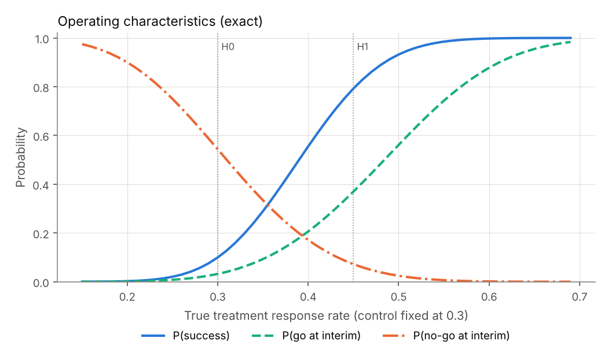
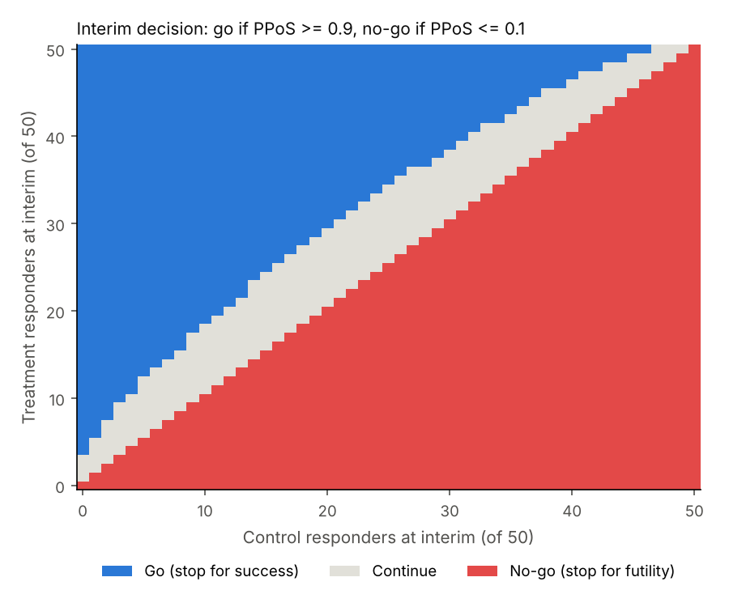

# Design memo: TD-101 phase 2, Bayesian go/no-go interim

*Fictional trial, written to show how `trialdesign` supports a design decision. Sections 1 to 5
were written with `trialdesign` 0.1.0 and the addenda with 0.2.0 to 0.4.0; version 0.4.0
reproduces every number, using the commands in the appendix.*

**To:** TD-101 clinical team · **From:** Trial statistics · **Decision needed:** sample size and
interim rule for the phase 2 study

## 1. The question

TD-101 is a new oral treatment being compared with standard of care. The primary endpoint is
clinical response at week 12, which is binary. About 30% of patients respond on standard of
care. The team considers a 15-point improvement, to 45%, clinically worthwhile and enough to
justify phase 3.

Phase 2 has to answer one question: **is TD-101 good enough to start phase 3?** It should say
yes when the true response rate is 45%, say no when TD-101 adds nothing, and stop early when the
answer is already clear.

## 2. The design

The design is two arms, 1:1, with one interim analysis at half enrolment and one final analysis.

- **Analysis model.** Beta(1, 1) (uniform) priors on each arm's response rate. The posterior is
  beta-binomial.
- **Final success.** The trial succeeds if P(p_T > p_C | data) ≥ η at the final analysis.
- **Interim.** Compute the predictive probability of success (PPoS): the chance the trial would
  succeed at the final analysis, averaged over the posterior predictive distribution of the
  patients still to come. **Go** (stop, recommend phase 3) if PPoS ≥ 0.9. **No-go** (stop for
  futility) if PPoS ≤ 0.1. Otherwise continue.
- **Calibration.** η is not chosen by hand. It is the smallest value whose *frequentist* type I
  error, P(success when p_T = p_C), stays at or below a target at every common response rate from
  0.05 to 0.95. Everything below is exact: the operating characteristics sum binomial
  probabilities over the decision tables, and a 200,000-trial simulation agrees within Monte
  Carlo error.

## 3. Operating characteristics

H0 means p_T = p_C = 0.30. H1 means p_T = 0.45. Assurance averages the probability of success
over a design prior p_T ~ Beta(4.5, 5.5), which has mean 0.45 and allows for uncertainty in the
effect (O'Hagan, Stevens and Campbell 2005). N counts patients in both arms.

| Design | A: package default | B | **C: recommended** | D |
| --- | --- | --- | --- | --- |
| Patients per arm (interim / final) | 30 / 60 | 30 / 60 | **50 / 100** | 90 / 180 |
| Type I error target (one-sided) | 0.025 | 0.10 | **0.10** | 0.025 |
| Success threshold η | 0.98 | 0.9068 | **0.9071** | 0.98 |
| Type I error at p_C = 0.30 (worst case) | 0.023 (0.023) | 0.100 (0.100) | **0.100 (0.100)** | 0.024 (0.025) |
| **Power at p_T = 0.45** | 0.36 | 0.63 | **0.79** | 0.81 |
| Assurance | 0.42 | 0.56 | **0.63** | 0.60 |
| P(go at interim), H1 | 0.11 | 0.25 | **0.37** | 0.39 |
| P(no-go at interim), H0 | 0.75 | 0.56 | **0.54** | 0.72 |
| P(no-go at interim), H1 | 0.29 | 0.14 | **0.07** | 0.06 |
| Expected N under H0 / H1 (maximum) | 74 / 96 (120) | 85 / 97 (120) | **142 / 156 (200)** | 230 / 280 (360) |

**Design A**, the package default, holds the type I error at one-sided 0.025. With 60 patients
per arm, however, it has only 36% power: it would miss a real 15-point improvement nearly two
times in three. To control 0.025 *and* reach 80% power, the trial needs about 180 per arm
(**design D**). That is close to the size of a phase 3 trial.

**Design C** treats phase 2 as what it is, a screen before a confirmatory trial. It accepts a
10% one-sided false-go rate, which is a common convention in phase 2 because phase 3 will
control 0.025 on its own. In return it gets 79% power with 100 patients per arm. Under H0 it
stops for futility at the interim more than half the time, so it uses 142 patients on average
instead of 200.



**The interim rule for design C**, in counts the team can read off directly, applies when
50 patients per arm have a week-12 response:

- **No-go** if the treatment arm has *no more* responders than control (for example 15 vs 15).
- **Go** if the treatment arm leads by about 10 responders (for example 25 or more vs 15).
- **Continue** to 100 per arm otherwise.



## 4. Risks and how the design handles them

- **The control rate may not be 30%.** The type I error is calibrated at its worst case over
  every common response rate, so it holds whatever the control rate turns out to be. Power is
  stable for a 15-point gain: 0.82 at 25% vs 40%, and 0.78 at 35% vs 50%.
- **The effect may be smaller.** At 30% vs 40% power falls to 0.56, and at 30% vs 35% to 0.29.
  Design C is built to detect 15 points. A 5-point gain will usually, and rightly, lead to no-go.
- **No-go must be followed.** Unlike the non-binding futility of the group-sequential designs,
  the no-go rule is part of the type I error calculation. If the team overrides a no-go and
  continues, the type I error at p_C = 0.30 rises from 0.100 to 0.106. The DMC charter should make no-go
  binding, or η should be recalibrated with no-go ignored.
- **An early go overstates the effect.** Under H1 (true difference 15 points), trials that stop
  for go show an average observed difference of about 25 points at the interim. Phase 3 should
  be sized on the full phase 2 estimate shrunk toward the prior, or on 15 points, never on the
  interim estimate.
- **Response takes 12 weeks.** Patients keep enrolling while the interim cohort reaches week 12.
  Their data should be added at the final analysis (not ignored), and the interim should be
  scheduled when 50 per arm have a week-12 assessment, not when 50 per arm are enrolled.
- **Model scope.** Dropout, stratification and covariates are not modelled. With 10% dropout,
  enrol about 112 per arm to keep 100 evaluable.

## 5. Recommendation

Run **design C**: 100 evaluable patients per arm with an interim at 50 per arm. Use go if
PPoS ≥ 0.9, no-go if PPoS ≤ 0.1, and final success if P(p_T > p_C | data) ≥ 0.9071, a threshold
calibrated to a worst-case one-sided false-go rate of 10%. Make the no-go rule binding in the DMC
charter. If governance requires phase 2 to control one-sided 0.025, the honest alternative is
design D (180 per arm), not the 60-per-arm default, which is underpowered for this effect.

## Addendum (v0.2): protecting phase 3 against a smaller effect

Section 4 warns that an early go overstates the effect. Phase 3 can be sized on the
15-point improvement and still guard against a smaller true effect, by re-estimating its
sample size at the interim (Mehta and Pocock 2011).

**Planned phase 3.** 30% vs 45%, one-sided alpha 0.025, 80% power, an interim at half the
patients with O'Brien-Fleming-type efficacy and non-binding futility: 344 patients (172 per
arm), interim at 172. **Rule.** At the interim, compute the conditional power at the observed
trend. If it is between 0.36 and 0.80 (the promising zone), enrol enough extra patients to
bring it to 0.80, up to twice the plan (688). Otherwise keep 344. The final analysis weights
the two stages by their planned sizes (Cui, Hung and Wang 1999), so the type I error stays
exactly 0.025 (0.0249 in 200,000 simulated trials).

| True improvement | Power, planned | Power, with re-estimation | Mean patients, planned | Mean patients, with re-estimation |
| --- | --- | --- | --- | --- |
| 15 points (as designed) | 0.80 | 0.83 | 302 | 336 |
| about 13 points | 0.66 | 0.71 | 304 | 344 |
| about 10.5 points | 0.50 | 0.55 | 300 | 342 |

The smaller improvements are 85% and 70% of the design effect on the z-scale. For example, an
interim z of 1.5 falls in the promising zone: conditional power at the observed trend is 0.59,
and the rule raises the trial to 518 patients.

**What it buys.** About 4 to 5 points of power for about 40 more patients on average. That is
cheap insurance if the team believes 15 points but fears 12. If 12 points is the effect phase 3
must detect, size for it from the start: 528 patients at most, 463 on average under that
effect, with no adaptive machinery to explain to regulators.

## Addendum (v0.3): checking the phase 3 design with simulated patients, and reporting it

**Does the design hold with real patients?** The boundaries above assume the canonical normal
z-process. The patient-level engine instead randomises 344 patients, draws responses, and
applies the Farrington-Manning z-test at each look (100,000 trials). Power holds (0.809 against
the planned 0.800), but the one-sided type I error is 0.0266 (MC SE 0.0005), not 0.025: with 86
patients per arm at the interim the z-test is slightly liberal at a 30% response rate. If the
protocol must hold 0.025 exactly, plan at one-sided 0.0235 (350 patients): the simulated type I
error is then 0.0243 and the power 0.804.

**Reporting the result.** The statistical analysis plan should name the analysis that matches
the design, not the fixed-sample one. Suppose the interim z is 1.4 (continue) and the final z
is 2.3. Stage-wise ordering gives a one-sided p-value of 0.0115 (the naive p is 0.0107), a
median-unbiased improvement of 11.9 points and a 95% confidence interval of 1.7 to 22.2 points.
With O'Brien-Fleming-type boundaries these are close to the naive values (12.0 points, 1.8 to
22.2), because almost no alpha is spent at the interim. Had the trial stopped at the interim, the
repeated confidence interval at that look would have been the one to quote, and it is wide (for
z = 3.1: 1.0 to 44.7 points).

## Addendum (v0.4): the phase 3 survival design under a delayed effect

**The question.** If TD-101 goes to phase 3, the survival comparison is sized for a hazard
ratio of 0.70 with proportional hazards
([`examples/phase3_survival_accrual.toml`](../examples/phase3_survival_accrual.toml)). That
design has a 12-month control median, 498 patients recruited over about 23.5 months with a
6-month ramp-up, and 307 events. It has three looks at 33%, 67% and 100% of the events, with
O'Brien-Fleming-type efficacy and non-binding Pocock-type futility. Immunotherapies often
help only after a lag. What happens if the treatment does nothing for the first 4 months
after entry and only then works with a hazard ratio of 0.70?

**What the delay does.** The table compares 10,000 simulated trials with proportional
hazards against 10,000 with the 4-month delay. Both use the same seed and the log-rank test,
and both follow the futility boundary.

| | Proportional hazards | 4-month delay |
| --- | --- | --- |
| Power | 0.793 | 0.364 |
| First look (101 events): month | 17.9 | 17.3 |
| First look: stop for futility | 0.091 | 0.403 |
| Second look: stop for futility | 0.069 | 0.173 |
| Expected duration (months) | 27.9 | 24.7 |

Power falls from 0.79 to 0.36. Most of the loss happens at the first look. At month 17 most
events so far fall in the first months after entry, when the two arms do not differ, so the
interim z is near zero. The Pocock futility boundary (z below 0.45) then stops 40% of trials
that would have shown a real benefit, against 9% under proportional hazards. The looks
themselves barely move: the events still arrive at about the planned months.

**What helps, and what it costs.** These figures come from 10,000 simulated trials each,
with the same 4-month delay followed by a hazard ratio of 0.70.

- *Drop futility* and keep the size: power is only 0.45, because the trial is too small for
  the diluted effect.
- *Use the Fleming-Harrington FH(0,1) test*, which weights late differences more. In
  `trialdesign` this is only available with a single analysis. With one look at the planned
  events it lifts power from 0.46 (log-rank) to 0.56. Its type I error was 0.027 (SE 0.0007) in 50,000 simulated trials, so
  check it again for the final design.
- *Size for the diluted effect.* Design for a hazard ratio of 0.78 while the truth is the
  delay, with no futility: 516 events, 747 patients and 45.5 months give a power of 0.80.
  Keeping the Pocock futility needs a design hazard ratio of 0.80: 785 events and 1,057
  patients for the same power.

**Recommendation.** If the mechanism makes a delay plausible, do not put a futility look at a
third of the events. Either size for the average effect (about 750 patients, no early
futility) or move the first look later and make it efficacy-only. Agree the delay assumption
with the clinical team before the sample size is fixed. `trialdesign report --delay 4` adds
this comparison, with survival curves per arm, to the design report.

## Appendix: reproduce every number

```bash
pip install gsdtrial==0.4.0
# Design A (package default, calibrated to one-sided 0.025)
trialdesign bayes --pc 0.30 --pt 0.45 --n 60 --interim 30 --design-prior-t 4.5,5.5
# Design B and C (calibrated to one-sided 0.10)
trialdesign bayes --pc 0.30 --pt 0.45 --n 60 --interim 30 --calibrate --alpha-one-sided 0.10 \
    --design-prior-t 4.5,5.5
trialdesign bayes --pc 0.30 --pt 0.45 --n 100 --interim 50 --calibrate --alpha-one-sided 0.10 \
    --design-prior-t 4.5,5.5 --nsim 200000 --seed 2026
# Design D
trialdesign bayes --pc 0.30 --pt 0.45 --n 180 --interim 90 --design-prior-t 4.5,5.5
# Full report with plots for design C
trialdesign report --pc 0.30 --pt 0.45 --n 100 --interim 50 --calibrate --alpha-one-sided 0.10 \
    --design-prior-t 4.5,5.5 --out results/memo
# Addendum: phase 3 with sample size re-estimation, the rule at z1 = 1.5, and a 12-point design
trialdesign ssr --endpoint binary --pc 0.30 --pt 0.45 --futility obf --nsim 200000 --seed 2026
trialdesign ssr --endpoint binary --pc 0.30 --pt 0.45 --futility obf --z1 1.5
trialdesign design --endpoint binary --pc 0.30 --pt 0.42 --looks 0.5,1 --futility obf
# Addendum v0.3: patient-level check, the 0.0235 design, and the end-of-trial analysis
trialdesign simulate --endpoint binary --pc 0.30 --pt 0.45 --looks 0.5,1 --futility obf \
    --engine patient --nsim 100000 --seed 2026
trialdesign simulate --endpoint binary --pc 0.30 --pt 0.45 --looks 0.5,1 --futility obf \
    --engine patient --nsim 100000 --seed 2026 --alpha-one-sided 0.0235
trialdesign design --endpoint binary --pc 0.30 --pt 0.45 --looks 0.5,1 --futility obf \
    --analyse 1.4,2.3
# Addendum v0.4: the phase 3 survival design with a 4-month delayed effect
trialdesign report --config examples/phase3_survival_accrual.toml --delay 4 --nsim 200000 \
    --seed 2026 --out results/delay
trialdesign simulate --config examples/phase3_survival_accrual.toml --engine patient \
    --delay 4 --nsim 10000 --seed 2026 --futility none
trialdesign simulate --config examples/phase3_survival_accrual.toml --engine patient \
    --delay 4 --looks 1 --nsim 10000 --seed 2026
trialdesign simulate --config examples/phase3_survival_accrual.toml --engine patient \
    --delay 4 --looks 1 --test fh:0,1 --nsim 50000 --seed 7
trialdesign simulate --config examples/phase3_survival_accrual.toml --engine patient \
    --delay 4 --hr-after 0.7 --hr 0.78 --futility none --nsim 10000 --seed 2026
trialdesign simulate --config examples/phase3_survival_accrual.toml --engine patient \
    --delay 4 --hr-after 0.7 --hr 0.80 --nsim 10000 --seed 2026
```

**References.** Berry, Carlin, Lee and Müller (2010), *Bayesian Adaptive Methods for Clinical
Trials*. Cui, Hung and Wang (1999), *Biometrics* 55, 853–857. Lee and Liu (2008), *Clinical
Trials* 5, 93–106. Mehta and Pocock (2011), *Statistics in Medicine* 30, 3267–3284. O'Hagan,
Stevens and Campbell (2005), *Pharmaceutical Statistics* 4, 187–201. Jennison and Turnbull
(1989), *JRSS B* 51, 305–361. Fleming and Harrington (1991), *Counting Processes and Survival
Analysis*. Tsiatis, Rosner and Mehta (1984), *Biometrics* 40, 797–803.
Spiegelhalter, Abrams and Myles (2004), *Bayesian Approaches to Clinical Trials and Health-Care
Evaluation*.
